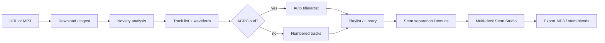

# Mix Station — DJ Mix Splitter & Stem Studio

Turn long DJ mixes into individual tracks, separate them into stems, and mix live on up to four decks — all in your browser, running locally on your machine.

Paste a YouTube URL (or upload an MP3) → the app **detects track boundaries**, optionally **names songs** via ACRCloud, lets you **review and export** 320 kbps MP3s, then opens **Stem Studio**: Demucs stem separation, a multi-deck mixer with **beat sync**, loops, EQ, and optional **vocal transcription**.

Everything runs at **http://127.0.0.1:8000**. No cloud hosting required.

---

## Platform support

| Platform | Supported | Launcher | Stem separation |
|----------|-----------|----------|-----------------|
| **macOS** (Apple Silicon) | Yes | `./run.sh` | Fast — PyTorch **MPS** GPU |
| **macOS** (Intel) | Yes | `./run.sh` | CPU |
| **Linux** | Yes | `./run.sh` | CPU (CUDA if configured) |
| **Windows 10/11** | Yes | `run.bat` | CPU (CUDA if configured) |
| **WSL2** (Ubuntu) | Yes | `./run.sh` | Same as Linux |

---

## Features

| Area | What you get |
|------|----------------|
| **Mix splitting** | Download audio (`yt-dlp`), detect track changes with Foote novelty analysis (`librosa`), tune sensitivity without re-downloading |
| **Track ID** *(optional)* | ACRCloud recognition for artist/title on each segment |
| **Export** | Per-track or batch MP3 export (320 kbps) plus ZIP |
| **Stem separation** | Vocals, drums, bass, kick, guitar, piano, synth, perc, other — quality tiers from fast vocal/instrumental to high-quality 6-stem |
| **Stem Studio** | Up to 4 decks, vertical tempo faders (±20%), per-deck **0** reset, waveform scratch, loops, stem mute/solo/volume, custom mix download |
| **Beat sync** | Mixer **SYNC** matches tempo to the longest-playing deck; phase LEDs show alignment |
| **Lyrics** *(optional)* | faster-whisper transcription on vocal stems, click-to-seek synced lyrics |
| **Library** | Previously analyzed mixes and tracks persist under `data/` and reload from **＋ Load → LIBRARY** |
| **Integrations** *(optional)* | Apple Music catalog search, Spotify OAuth playback |

---

## How it works



1. **Download** — `yt-dlp` fetches audio; `ffmpeg` normalizes to WAV for analysis.
2. **Analyze** — MFCC + chroma + spectral features → self-similarity matrix → Foote checkerboard novelty peaks = track boundaries. Segments shorter than ~75 s are merged.
3. **Identify** *(optional)* — ~18 s clip per segment sent to ACRCloud. Without keys, tracks stay numbered (nothing is guessed).
4. **Export** — `ffmpeg` cuts each region to tagged 320 kbps MP3.
5. **Stems** — [Demucs](https://github.com/facebookresearch/demucs) (`htdemucs` / `htdemucs_6s`). First run downloads models (~80 MB+). Results cached on disk.
6. **Studio** — Web Audio API plays stems in sync; BPM detected per track for sync and bar-aligned loops.
7. **Lyrics** — [faster-whisper](https://github.com/SYSTRAN/faster-whisper) on the vocal stem; cached to disk.

---

## Requirements

### Hardware

- **RAM:** 8 GB minimum; **16 GB+** recommended for stem separation on long tracks
- **Disk:** Several GB free — source WAVs, stems, and exports live under `data/` (grows quickly on long mixes)
- **GPU:** Optional. Apple Silicon MPS or NVIDIA CUDA speeds up Demucs; CPU-only works everywhere but is slower

### Software

| Tool | Purpose |
|------|---------|
| **Python 3.10+** | Backend (3.11–3.13 tested) |
| **ffmpeg** | Audio decode/encode — **required** |
| **git** | Clone the repo |

Optional accounts (app works without them):

- [ACRCloud](https://console.acrcloud.com) — song identification
- [Apple Developer](https://developer.apple.com) — MusicKit search/playback
- [Spotify Developer](https://developer.spotify.com/dashboard) — catalog + OAuth playback

---

## Installation

### 1. Clone the repository

```bash
git clone https://github.com/UmbusoWeqiniso/dj-mix-splitter.git
cd dj-mix-splitter
```

If the repo is private, use SSH or a personal access token with HTTPS.

### 2. Install Python

| Platform | Steps |
|----------|--------|
| **macOS** | `brew install python@3.12` or use [python.org](https://www.python.org/downloads/) |
| **Linux** | `sudo apt install python3 python3-venv python3-pip` |
| **Windows** | [python.org/downloads](https://www.python.org/downloads/) — tick **“Add python.exe to PATH”** |

Verify: `python3 --version` (macOS/Linux) or `py -3 --version` (Windows)

### 3. Install ffmpeg

| Platform | Command / steps |
|----------|-----------------|
| **macOS** | `brew install ffmpeg` |
| **Linux** | `sudo apt update && sudo apt install -y ffmpeg` |
| **Windows** | Download [ffmpeg essentials build](https://www.gyan.dev/ffmpeg/builds/), unzip, add the folder containing `ffmpeg.exe` to **PATH** (Settings → Environment Variables) |

Verify (all platforms):

```bash
ffmpeg -version
```

The server refuses stem/export jobs if `ffmpeg` is missing.

### 4. Configure environment *(optional)*

macOS / Linux:

```bash
cp .env.example .env
```

Windows:

```bat
copy .env.example .env
```

Edit `.env` for any services you want. **Minimum setup:** leave ACRCloud blank — splitting and stems still work; tracks are numbered instead of named.

See [Configuration](#configuration) for all variables.

### 5. Install dependencies and start

**Option A — launcher (recommended)**

| Platform | Command |
|----------|---------|
| macOS / Linux | `chmod +x run.sh && ./run.sh` |
| Windows | `run.bat` |
| WSL2 | `./run.sh` |

First run creates `.venv/`, installs `requirements.txt`, and starts the server. `torch` + `demucs` are large — first install may take several minutes.

**Option B — manual**

macOS / Linux:

```bash
python3 -m venv .venv
source .venv/bin/activate
pip install --upgrade pip
pip install -r requirements.txt
cd backend
uvicorn app:app --host 127.0.0.1 --port 8000
```

Windows:

```bat
py -3 -m venv .venv
.venv\Scripts\activate
pip install --upgrade pip
pip install -r requirements.txt
cd backend
uvicorn app:app --host 127.0.0.1 --port 8000
```

Open **http://127.0.0.1:8000** in Chrome, Safari, or Firefox.

---

## Running the project

| Action | macOS / Linux | Windows |
|--------|---------------|---------|
| **Start** | `./run.sh` | `run.bat` |
| **Stop** | `Ctrl+C` in the terminal | `Ctrl+C` in the terminal |
| **Custom port** | `PORT=9000 ./run.sh` | `set PORT=9000` then `run.bat`, or pass uvicorn args |

Update `SPOTIFY_REDIRECT_URI` in `.env` if you change the port.

---

## Getting started (first session)

### Split a mix

1. Click **＋ Load** in the header.
2. Paste a **YouTube / SoundCloud / direct audio URL** and press **⏎**, **or** choose **Browse files** for a local MP3/WAV.
3. Wait for download → analyze → (optional) identify. Progress appears in the playlist LCD.
4. Review tracks: edit title/artist, adjust boundaries, change **sensitivity** and **Re-split** without re-downloading.
5. Export selected tracks as MP3 or ZIP.

### Open Stem Studio

1. Load tracks onto **Deck 1** and **Deck 2** (two decks open by default).
2. Press **▶** on a deck. Stem separation queues automatically (or click **STEM**).
3. Watch the deck LCD for **SEPARATING** progress; stems cache to disk.
4. Use **mute / solo / volume**, **EQ**, **loops**, and the vertical **TEMPO** fader (±20%).
5. Press **SYNC** on the mixer — followers match the **longest-playing** deck’s effective BPM.
6. Press **0** on a deck tempo rail to smoothly reset pitch to +0.0%.

### Reload previous work

**＋ Load → LIBRARY** lists mixes on disk under `data/`. Click a track to add it to the playlist or load a deck.

---

## Configuration

All settings are read from `.env` in the project root (see `.env.example`).

### Core

| Variable | Default | Description |
|----------|---------|-------------|
| `DATA_DIR` | `./data` | Downloads, stems, exports, caches |

On Windows, prefer forward slashes in `.env`, e.g. `DATA_DIR=D:/mixstation/data`.

### ACRCloud (song names)

| Variable | Description |
|----------|-------------|
| `ACRCLOUD_HOST` | e.g. `identify-eu-west-1.acrcloud.com` |
| `ACRCLOUD_ACCESS_KEY` | Project access key |
| `ACRCLOUD_ACCESS_SECRET` | Project secret |

Setup: [ACRCloud Console](https://console.acrcloud.com) → **Audio & Video Recognition** project → copy credentials.

### Vocal transcription (lyrics)

| Variable | Default | Description |
|----------|---------|-------------|
| `WHISPER_MODEL` | `base` | `tiny` / `base` / `small` / `medium` |
| `WHISPER_LANGUAGE` | *(auto)* | Force language, e.g. `en` |

### Apple Music *(optional)*

| Variable | Description |
|----------|-------------|
| `APPLE_MUSIC_TEAM_ID` | Apple Developer Team ID |
| `APPLE_MUSIC_KEY_ID` | MusicKit Key ID |
| `APPLE_MUSIC_PRIVATE_KEY` or `APPLE_MUSIC_PRIVATE_KEY_PATH` | `.p8` key |
| `APPLE_MUSIC_STOREFRONT` | e.g. `us` |

### Spotify *(optional)*

| Variable | Description |
|----------|-------------|
| `SPOTIFY_CLIENT_ID` | App client ID |
| `SPOTIFY_CLIENT_SECRET` | App secret |
| `SPOTIFY_REDIRECT_URI` | Default `http://127.0.0.1:8000/api/services/spotify/callback` |

### Stem separation performance

| Variable | Default | Description |
|----------|---------|-------------|
| `STEM_DEFAULT_QUALITY` | `balanced` | `vocal` / `fast` / `balanced` / `high` |
| `STEM_MAX_CONCURRENCY` | `1` | Parallel separations (keep at 1 on laptops) |
| `STEM_TORCH_THREADS` | half CPU cores | PyTorch thread cap |
| `STEM_JOB_TTL` | `1800` | Retain finished job metadata (seconds) |
| `STEM_MODEL_IDLE` | `300` | Unload Demucs after idle seconds |

**Quality presets** (also in Settings UI):

| Preset | Stems | Typical speed |
|--------|-------|----------------|
| **vocal** | vocals + instrumental | Fastest |
| **fast** | vocals, kick, drums, bass, other | ~1 min / track |
| **balanced** | 8 stems (6-source + kick/HPSS) | ~2–3 min / track |
| **high** | balanced, model run twice | ~4–8 min / track |

### Analysis tunables

Edit `backend/config.py`:

| Constant | Default | Meaning |
|----------|---------|---------|
| `MIN_TRACK_SECONDS` | `75` | Minimum segment length before merging |
| `ANALYSIS_SAMPLE_RATE` | `22050` | Feature extraction sample rate |
| `ID_SAMPLE_SECONDS` | `18` | Clip length sent to ACRCloud |

---

## Project layout

```
dj-mix-splitter/
├── run.sh                 # macOS / Linux launcher
├── run.bat                # Windows launcher
├── requirements.txt
├── .env.example           # copy → .env (not committed)
├── .gitignore             # excludes .env, .venv/, data/
├── data/                  # runtime storage (not in git)
├── backend/
│   ├── app.py             # FastAPI + static frontend
│   ├── jobs.py            # download → analyze → identify
│   ├── analysis.py        # Foote novelty segmentation
│   ├── stems.py           # Demucs separation
│   └── …
└── frontend/
    ├── index.html
    ├── app.js             # mix splitting, playlist, library
    ├── stems.js           # decks, sync, stems
    └── …
```

---

## API overview

| Endpoint | Purpose |
|----------|---------|
| `GET /api/health` | Server status |
| `GET /api/resources` | CPU/RAM/disk |
| `POST /api/jobs` | Start URL download + analysis |
| `POST /api/jobs/upload` | Upload local audio |
| `GET /api/jobs/{id}` | Job status + tracks |
| `POST /api/jobs/{id}/redetect` | Re-segment with new sensitivity |
| `GET /api/cached` | On-disk library |
| `POST /api/jobs/{id}/stems` | Queue stem separation |
| `GET /api/storage` | Disk usage |

Interactive docs: **http://127.0.0.1:8000/docs**

---

## Troubleshooting

### `ffmpeg is not installed`

Install ffmpeg, ensure it is on **PATH**, restart the server. See [Install ffmpeg](#3-install-ffmpeg).

### Stem separation is slow

- **Settings** → quality **vocal** or **fast**
- Keep `STEM_MAX_CONCURRENCY=1`
- On Windows without NVIDIA CUDA, expect CPU-only separation (slower than Apple Silicon MPS)
- Close other heavy apps

### Mixes missing from Library

Library reads `data/` on disk. Copy your `data/` folder when moving machines, or re-analyze URLs. Refresh via **＋ Load → LIBRARY**.

### SYNC doesn’t match tempo

- Both decks need **BPM** (play once or wait for analysis)
- Press **SYNC** with at least one deck **playing**
- Hard-refresh after updates (`Cmd+Shift+R` / `Ctrl+Shift+R`)

### Port already in use

macOS / Linux:

```bash
lsof -i :8000
kill <PID>
./run.sh
```

Windows (PowerShell):

```powershell
netstat -ano | findstr :8000
taskkill /PID <PID> /F
run.bat
```

Or use another port (see [Running the project](#running-the-project)).

### Reinstall Python dependencies

macOS / Linux: `rm -rf .venv && ./run.sh`

Windows: delete `.venv` folder, then run `run.bat`

### ACRCloud / Spotify / Apple Music not working

Check `.env` credentials and restart the server. Each integration is optional.

---

## Storage & privacy

- Audio and analysis stay under **`DATA_DIR`** (default `./data/`).
- **Do not commit `.env`** — listed in `.gitignore`.
- **`data/` is not in git** — back it up separately.

Use **Settings → Storage** to inspect disk usage and clear stem caches.

---

## Legal & responsible use

Local tool for **personal use**. DJ mixes may be copyright-protected. Respect artists and platform terms (YouTube, SoundCloud, etc.). Only process content you have the right to use.

---

## Development

```bash
source .venv/bin/activate   # Windows: .venv\Scripts\activate
cd backend
uvicorn app:app --host 127.0.0.1 --port 8000 --reload
```

Bump `?v=` query strings in `frontend/index.html` when browser caches stale JS/CSS.

---

## License

Private repository — all rights reserved unless otherwise specified by the repository owner.
